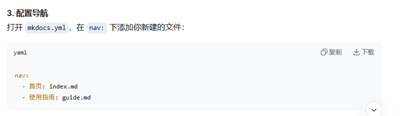
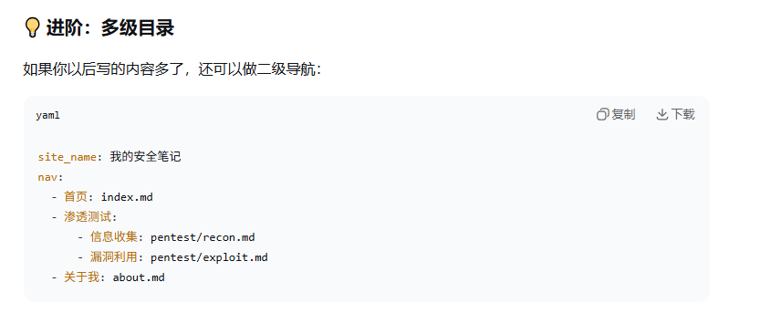

# MkDocs

# 安装(cmd)
## `pip install mkdocs`

# 验证
## `mkdocs --version`

# 主题
## 推荐安装 Material 主题
## `pip install mkdocs-material`

# 创建新项目
## `mkdocs new mydocs`
## `cd my-docs`

# 目录结构
## my-docs/
## ├── docs/
## │   └── index.md      # 首页内容
## └── mkdocs.yml        # 配置文件

# 本地预览
## `mkdocs serve`
## 浏览器访问`http://127.0.0.1:8000`

# 配置文件(mkdocs.yml)
## site_name: 我的文档
## theme:
##   name: material
## nav:
##   - 首页: index.md
##   - 使用指南: guide.md
##   - 关于: about.md

# 写入文档
## 先生成.md文件
## 再打开mkdocs.yml在nav.下添加新建的文件
## 如果没有nav.就手动输入nav.

# 注意
## 新生成的.md文件要放在/docs文件夹里
## - 后面必须有空格;: 后面也要有空格

# 插入图片
## 将图片/docs文件夹里,或者在/docs文件夹里新建一个专门放图片的文件夹

# 进阶

# 静态文件
## 生成的静态文件放在/site文件夹里,点开index.html即可查看(里面的zip文件可以分享给他人)

# 部署到 GitHub Pages
## mkdocs gh-deploy
